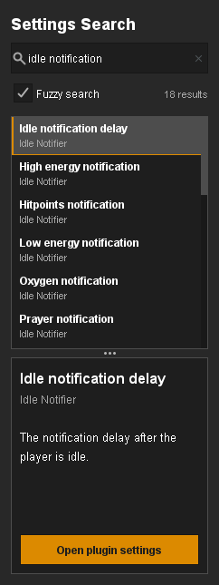

# Settings Search

Find individual RuneLite settings across built-in and installed Plugin Hub plugins, including disabled plugins. Search by setting name, plugin, section, description, or keyword.

## Install

Open **Plugin Hub** in RuneLite, search for **Settings Search**, and click **Install**.

- Open the magnifying glass in the RuneLite sidebar and try `idle notification` or `zoom limit`.
- **Fuzzy search** matches common typos such as `notificaiton`. Hover over the checkbox for an explanation. RuneLite remembers the choice in the current profile.
- Select a result to read its description. Drag the divider to give the results or description more room. Double-click the result or use **Open plugin settings** to jump to the plugin's configuration page.

The index uses metadata from RuneLite's standard configuration panels. It includes RuneLite and Chat Color. Custom controls outside the standard panels are outside its scope. Searches run locally.
